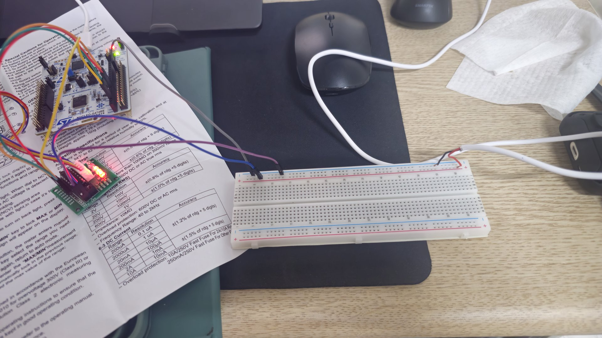

# 28BYJ-48 구동 실험

NUCLEO-G474RE로 28BYJ-48 스텝모터를 ULN2003 드라이버로 돌려 본 실험이다.

- 실험일: 2026-11-02
- 코드: [step_motor](../../Project_code/step_motor)
- 결과: 버튼 입력으로 모터 구동 확인
- 영상: [YouTube](https://www.youtube.com/shorts/aOwYWziigPU)

## 사진

| 파일 | 내용 | 원본 이름 |
|---|---|---|
| [1_setup_overview.jpg](1_setup_overview.jpg) | 보드, 드라이버, 브레드보드 전원까지 나온 전체 구성 | `20261102_220945.jpg` |
| [2_nucleo_wiring.jpg](2_nucleo_wiring.jpg) | NUCLEO-G474RE 보드와 핀 배선 | `20261102_220939.jpg` |
| [3_driver_motor_wiring.jpg](3_driver_motor_wiring.jpg) | 모터, 드라이버, 브레드보드 연결 | `20261102_220935.jpg` |
| [4_uln2003_led_on.jpg](4_uln2003_led_on.jpg) | ULN2003 드라이버 근접 사진. LED 2개가 켜져 있음 | `20261102_220926.jpg` |

코드가 항상 코일 2개를 켜는 2상 여자 방식이라서, 사진에서도 ULN2003의 LED가 2개 켜져 있다.

## 저장소에 포함하지 않는 폴더

- `원본/`: 축소 전 원본 사진
- `영상/`: 실험 영상

사진은 1920x1080으로 줄여서 올렸다.
