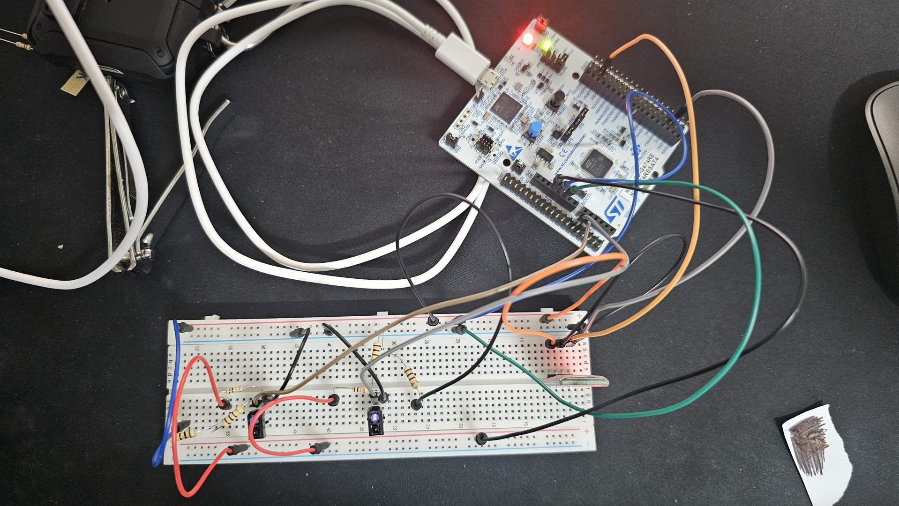
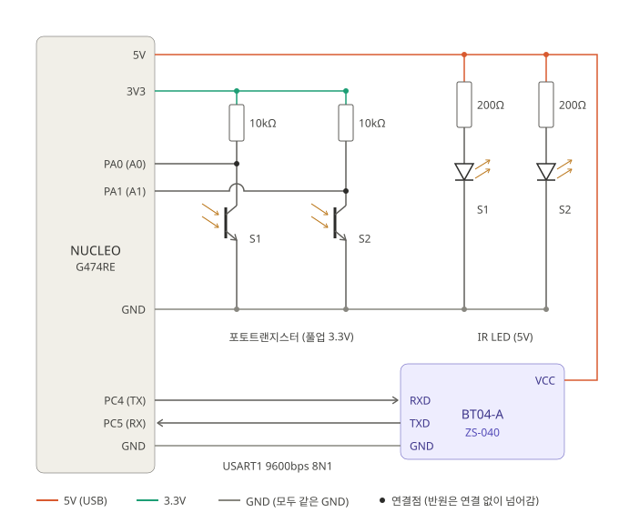

# TCRT5000 2채널 읽기 실험

NUCLEO-G474RE의 ADC1 + DMA로 TCRT5000 센서 2개 값을 읽고, USART1과 블루투스 모듈(BT04-A)로 PC의 Tera Term에 보내 본 실험이다.

- 실험일: 2026-11-10
- 코드: [ADC_TCRT5000](../../Project_code/ADC_TCRT5000)
- 결과: 흰색과 검은색에서 ADC 값 차이가 크게 나는 것을 확인

## 회로도

- IR LED: 5V(USB) → 200Ω → LED. 약 19mA
- 포토트랜지스터: 3.3V → 10kΩ 풀업 → 컬렉터 → PA0 / PA1, 이미터는 GND
- 블루투스 BT04-A(ZS-040 기판): VCC 5V, PC4(TX) → RXD, TXD → PC5(RX)

## 측정 결과

센서를 바닥에서 2~5mm 높이에 두고 Tera Term에 찍힌 값을 읽었다. ADC는 12bit(0~4095)이다.

| 바닥 | ADC 값 | 전압(약) |
|---|---|---|
| 흰 종이 | 약 200 | 0.16V |
| 두꺼운 검정 | 약 2000 | 1.6V |
| 검은 금속 (무광) | 3000 이상 | 2.4V 이상 |
| 공중 (반사 없음) | 약 3900 | 3.15V |
| 얇은 검정 (매직) | 흰 종이와 비슷 | - |

- 흰색은 반사가 많아 포토트랜지스터 전류가 커지고, 컬렉터 전압이 내려가서 값이 작다.
- 얇은 매직 자국은 적외선(950nm)이 통과해서 아래 흰 종이에 반사되기 때문에 검은색으로 보이지 않았다.
- 흰색과 검은색의 중간값(약 1100)을 기준으로 잡으면 구분할 수 있다. 실제 트랙 재료로 다시 재야 한다.

## 사진

| 파일 | 내용 | 원본 이름 |
|---|---|---|
| [1_setup_overview.jpg](1_setup_overview.jpg) | 보드, 브레드보드, 센서 2개, 블루투스 모듈이 나온 전체 구성. 오른쪽 아래는 매직으로 칠한 시험 종이 | `20261110_015740.jpg` |
| [2_tcrt5000_sensors.jpg](2_tcrt5000_sensors.jpg) | TCRT5000 2개와 저항 근접 사진. IR LED가 카메라에 보라색으로 보임 | `20261110_015750.jpg` |
| [3_bt04a_module.jpg](3_bt04a_module.jpg) | 블루투스 모듈 BT04-A와 USART1 배선 | `20261110_015756.jpg` |
| [4_nucleo_wiring.jpg](4_nucleo_wiring.jpg) | NUCLEO-G474RE 보드 쪽 배선 | `20261110_015759.jpg` |
| [circuit_schematic.svg](circuit_schematic.svg) | 전체 회로도 | - |

## 실험 중 겪은 문제

- 풀업 저항 한쪽 끝이 아무 데도 꽂혀 있지 않아서(floating) 한 센서 값이 300 근처에서 떠다녔다. 3.3V에 꽂은 뒤 정상이 됐다.
- 센서 위로 지나가는 점퍼선과 저항 다리도 적외선을 반사하므로, 센서 위는 비워 두는 게 좋다.

## 저장소에 포함하지 않는 폴더

- `원본/`: 축소 전 원본 사진
- `영상/`: 실험 영상 (`tcrt5000_white_black_test.mp4`, 원본 이름 `20261110_015558.mp4`). 센서를 흰 휴지와 검은 바닥 위로 움직이면서 Tera Term 값이 바뀌는 모습

사진은 1920x1080으로 줄여서 올렸다.
